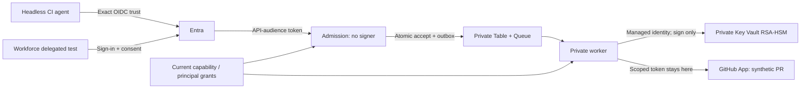

# Why this demo exists, and how it was built with Copilot

**Demo 18:** a reproducible engineering example, not a claim that an AI agent has
been made into a native GitHub user.

The complete source is here. This teaching edition derives from
[`entra-github-agent-identity-demo`](https://github.com/xavierxmorris/entra-github-agent-identity-demo)
at commit `e4ca200760769a2e6a4bf9fc7eea3e606be96c88`. The original repository is
preserved. Only committed, already sanitised source was copied; no deployment
state, tokens, meeting transcript or customer drawing came with it.

## 1. The problem, without the product shorthand

A headless agent needs to request work without borrowing a human's broad,
long-lived GitHub credentials. Operators also need to know its owner, allowed
capabilities, triggering workload, environment and revocation path.

These are two different authorisation questions:

| Question | Authority in this design |
| --- | --- |
| May this workload, or this user plus calling application, request this capability now? | Entra-authenticated identity plus the broker's current policy registry |
| What repository operations may the resulting integration perform? | The GitHub App installation, downscoped installation token and repository rules |

The broker connects the decisions. GitHub repository APIs do **not** accept the
Entra access token as an automatically mapped GitHub agent identity.

For millions of bank customers, keep customer authentication/authorisation in
the customer application plane. Only approved engineering capabilities cross
into the GitHub plane. Do not allocate a GitHub account, App or Entra service
principal for every customer or every run. Stable agent/security boundaries
need governance; transient executions need correlation IDs.

## 2. Why these design choices

| Choice | Reason | Cost or remaining limitation |
| --- | --- | --- |
| Operation broker, not token vending | Enforce the meaning of one synthetic maintenance operation on the server; the caller never receives repository-write credentials | A general coding agent would need additional separately reviewed capabilities |
| Separate admission and worker processes/identities | An Internet-facing admission endpoint has no signer or GitHub client | Admission can still write trusted decisions; compromise is not harmless |
| Entra workload federation | CI authenticates without a stored Entra secret | Exact repository/environment trust depends on protected workflows and branches |
| Separate delegated scope | Preserve user-and-client authorisation rather than pretending an app-only token is a user | Real sign-in, consent and Conditional Access remain |
| GitHub App | Repository-scoped permissions and short-lived installation tokens | GitHub records the App actor, not the originating Entra user |
| Private Key Vault remote signing | Keep the App key out of ordinary job steps | GitHub generates the key; HSM protection starts after trusted import |
| Table ledger + same-partition outbox + Queue | Accept durably, survive restarts and tolerate duplicate delivery | Azure/GitHub cannot commit atomically; ambiguity remains explicit |
| Private data endpoints and separate B1 plans | Demonstrate meaningful isolation without Kubernetes/registry/gateway overhead | About USD 60/month at low usage; no WAF, zone-redundant compute or regional DR |
| No write-credential fallback | Entra/broker authorisation remains a mandatory condition | Missing admin permission must stop the operation, not make the demo turn green |

If a workload only needs its own repository and Entra is **not** a mandatory
condition for GitHub writes, read-only-by-default `GITHUB_TOKEN` with explicitly
scoped permissions may be a simpler architecture. This broker solves the
stronger governance requirement; it is not a universal replacement.

## 3. The simplified drawing



The public API is intentionally reachable by hosted CI and the test client.
VNet integration is **outbound** networking; it does not make inbound access
private. Worker ingress and the vault/storage public data endpoints are disabled
separately. See [architecture](docs/architecture.md) for audit and residual risks.

## 4. How the original build actually progressed

This is a sanitised reconstruction of observed steps, **not a verbatim private
conversation or a deterministic recipe that always generates identical code**.
Reusable prompts are in [PROMPTS.md](PROMPTS.md).

| Stage | What we did with Copilot | Concrete output / check |
| --- | --- | --- |
| Bound the scenario | Turn the identity discussion into a fixed operation, two caller modes and explicit non-goals | Only synthetic `demo/maintenance.json` plus a PR; never merge |
| Ground the claims | Consult Microsoft Learn and GitHub documentation before choosing federation, key handling, private networking and deployment | Sources in [architecture](docs/architecture.md) and [runbook](docs/runbook.md) |
| Build a narrow baseline | Generate ASP.NET Core JWT policy, repository binding, remote signing and safe transport | Initial Release baseline: 98 tests passed |
| Challenge the baseline | Identify memory-only state, public dependencies and combined admission/signing authority | Revised architecture approved before further implementation |
| Divide substantial work | Use a bounded application/tests implementation task while the main session owned infrastructure and scripts | Non-overlapping file ownership; integration against exact config/entity schemas |
| Harden execution | Add live policy, durable operations/outbox, ETags, expiry, installation budgets and read-only reconciliation | Hardened baseline: 177 broker tests passed |
| Build the operating path | Write Bicep, Entra setup, sandbox protection, manifest approval/key import, policy seeding, deployment and cleanup | Offline script checks, Bicep compile and resource-specific Checkov review |
| Try real setup | Verify accounts, create isolated identity resources and attempt required custom API grants | Actual Entra `403 Authorization_RequestDenied`; paid compute was not deployed |
| Publish evidence | Push sanitised source and an immutable package, then run hosted CI | Original CI/release links in [evidence](docs/evidence.md) |
| Package this lab | Preserve source history and add rationale, prompts, runner and workshop | This demo repository; no new cloud deployment implied |

Copilot helped with decomposition, source research, implementation, diagnostics
and documentation. Compilers/tests, Azure/Graph responses and GitHub checks
provided evidence. Human decisions authorised live changes and determine
acceptable risk. There was no measured productivity comparison or independent
dual-model security review; do not invent either.

### Real issues caught, not a success-only story

- The initial Azure dependency combination produced duplicate credential types.
  The committed package set explicitly pins `Azure.Core` and avoids the old
  conflicting `Azure.Identity` reference.
- The first Checkov scan found failures, including legacy-schema checks and
  explicit availability tradeoffs. Each resource exception is documented;
  the claim is **not** that every default policy passed.
- A filtered Graph assignment query returned `400 Request_UnsupportedQuery`.
  Provisioning now enumerates the small demo application's assignments and
  matches locally.
- The subsequent assignment returned `403 Authorization_RequestDenied`.
  This is a real permission boundary, not an error solved by removing security.

## 5. Rebuild and verify the committed implementation

Recorded environment: PowerShell 7.4+, .NET SDK 10.0.401, Azure CLI 2.87.0,
Bicep 0.46.1, Checkov 3.3.19, MSAL.NET 4.90.1; CLI help inspected at Copilot
1.0.90-1 on 2026-09-29. These are evidence versions, not a claim that older
documentation or every future version has identical behavior.

```powershell
git clone https://github.com/xavierxmorris/ghcp-demo-18-entra-github-agent-identity.git
Set-Location .\ghcp-demo-18-entra-github-agent-identity
.\go.ps1 -Check
.\go.ps1 -Verify -NoBrowser
```

`-Check` checks files only. `-Verify` restores declared dependencies, builds and
tests the broker, builds the delegated client, and runs script/runner contracts.
First restore needs package-network access; after that, application tests do
not call Entra, Azure or GitHub. They do not require `az login`, `gh auth login`,
an App key or a deployed storage account.

For the separate infrastructure gate, use Azure CLI/Bicep and Checkov:

```powershell
az bicep build --file .\infra\main.bicep
checkov -d .\infra --framework bicep --quiet
```

Use an isolated environment if Checkov is not installed:

```powershell
python -m venv .\.local\scanner
& .\.local\scanner\Scripts\python.exe -m pip install checkov==3.3.19
& .\.local\scanner\Scripts\python.exe .\.local\scanner\Scripts\checkov `
  -d .\infra --framework bicep --quiet
```

The recorded Windows installation exposed `Scripts\checkov` and `checkov.cmd`,
not `checkov.exe`. Use the entrypoint installed by your package environment.
Never weaken TLS to get dependency installation to work.
Read [the documented scan exceptions](docs/infrastructure-checks.md), not just
the exit code.

### Files to understand before changing anything

| Files | Responsibility |
| --- | --- |
| `Program.cs`, `Configuration.cs`, `IdentityPolicy.cs` | Process separation, JWT configuration and caller classification |
| `AdmissionService.cs`, `DurableContracts.cs` | Authorised acceptance and operation/status contract |
| `AzureStorage.cs`, `Worker.cs` | Atomic outbox, persistent ownership, queue handling and installation budget |
| `MaintenanceOperation.cs`, `GitHubTransport.cs`, `AppJwtFactory.cs` | Fixed synthetic PR, bounded GitHub calls and remote signing |
| `tests/MaintenanceBroker.Tests/` | Positive, negative, crash, race, expiry and Azure-adapter contracts |
| `infra/` | Private dependencies, app modes, identities, DNS and scoped RBAC |
| `scripts/` | Explicit administrator/bootstrap/deployment/recovery actions |
| `templates/` | Sandbox-only workflow templates; not automatically executed by this source repository |
| `tools/DelegatedClient/` | Real workforce sign-in and caller-isolated operation polling |

## 6. Recreate the design with Copilot, rather than merely clone it

Use a disposable working copy and [the staged prompts](PROMPTS.md). Start with
requirements and the acceptance matrix; do not ask for a cloud deployment in
the same prompt as an architectural brainstorm.

```powershell
.\go.ps1 -Live
```

This launches **real interactive Copilot authoring** in the current clone with
an initial read-only planning request. It does not start Azure provisioning.
The runner adds no `--allow-all` flags. Your existing permissions/configuration
still apply: inspect them in the CLI and review requested actions. The prompt
and `AGENTS.md` are guidance, not a sandbox.

The portable prerequisites are the repository context, current-source access,
bounded requirements and executable tests. Optional skills and custom agents
can help, but this repository does not install or depend on the author's
personal plugin set. A selected model is not a substitute for a test oracle.

## 7. Build the live Azure environment only after a separate decision

Follow [the full runbook](docs/runbook.md). Do not copy an existing author's
state file. Choose a new disposable GitHub sandbox and isolated Azure naming
prefix/resource group, review cost and obtain approval.

The sequence is: local state -> Entra registrations/grants -> protected GitHub
sandbox -> CI federation -> private Azure infrastructure -> App approval and
trusted key import -> registry seeding -> immutable package deployment ->
explicit enablement -> workload and delegated live tests -> cleanup.

For publishing this edition's binary, the repository parameter is:

```powershell
.\scripts\Publish-Package.ps1 `
  -PublicRepository 'YOUR-USER/ghcp-demo-18-entra-github-agent-identity' `
  -AcknowledgePublicBinaryPublication
```

Use your own authorised fork for a workshop; do not publish participant builds
into the author's repository. An immutable release in the original repository
is baseline evidence, not a release automatically copied to this new repo.

**The permission lesson:** Azure subscription Owner does not confer Entra
directory administration. The original live setup stopped at the custom API
grant. An authorised tenant administrator must perform the
[narrow admin handoff](docs/runbook.md#if-tenant-permission-grants-are-denied).
No amount of better prompting legitimately replaces that authority.

## Sources and currency

Service architecture and SDK sources were retrieved on **2026-09-29** and are
linked in [architecture](docs/architecture.md), [runbook](docs/runbook.md) and
[evidence](docs/evidence.md). Recheck tenant-specific policies, quotas and prices
before running a later workshop.

Copilot usage was checked against installed `copilot --help` and the CLI's
authoritative help output. Public reference:
[GitHub Copilot CLI](https://docs.github.com/en/copilot/how-tos/use-copilot-agents/use-copilot-cli).
